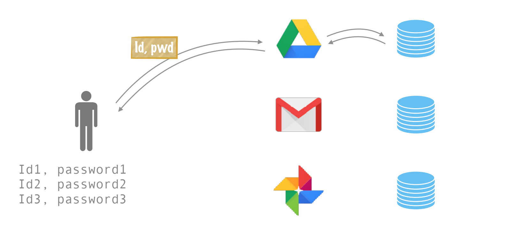
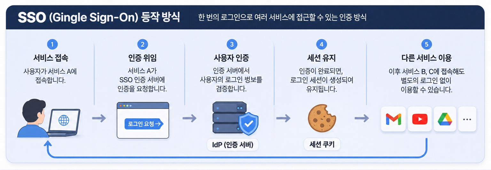
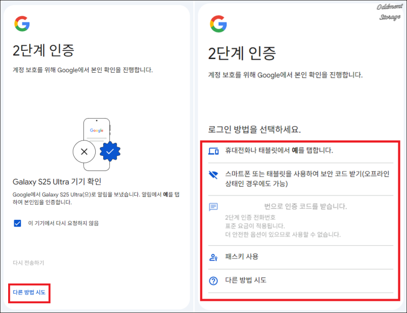
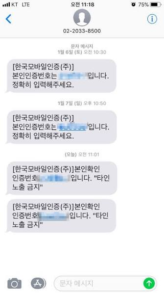
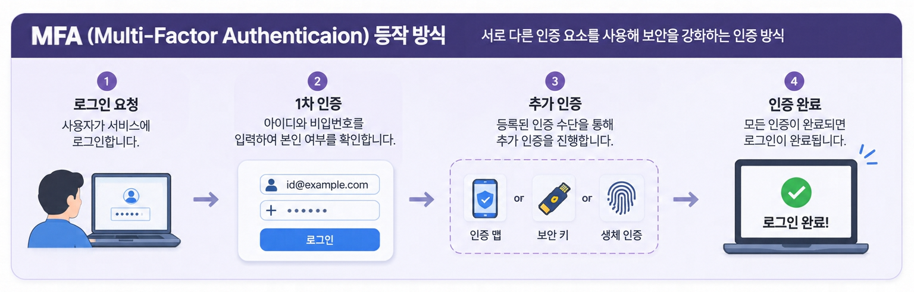

# SSO(Single Sign-On)란?


**SSO(Single Sign-On)** 는 한국어로는 **통합인증**이라고 합니다.

예를 들어보겠습니다.  
브라우저에서 Gmail에 로그인했다고 해봅시다. (Google, YouTube, Google Drive 등)

저희가 이 서비스 중 하나에서 로그인을 하면 다른 서비스에 접속할 때 다시 로그인하지 않아도 이미 로그인한 계정을 이용할 수 있습니다.  
이게 바로 SSO입니다.

**그렇다면 다른 서비스에 접속할 때 로그인 화면이 뜨지 않는 이유는 무엇일까요?**

이유는 이미 Google에서 인증을 받은 사용자의 로그인 상태가 유지되고 있기 때문입니다.

인증 서버(IdP)의 도메인에 로그인 세션 쿠키가 남아 있기 때문에, 다른 서비스에서 인증을 요청하더라도 인증 서버가 해당 쿠키를 확인하여 사용자가 이미 로그인한 상태인지 확인할 수 있습니다.

> 세션 : 서버가 사용자의 로그인 상태와 정보를 일정 기간 저장하여, 이후 요청에서도 사용자를 식별하고 인증 상태를 유지하는 방식

## SSO의 장점

- 사용자 경험 향상 : 사용자가 ID와 비밀번호를 기억하고 치는 수고와 번거로움을 줄입니다.
- 생산성 향상 : 사용자가 불편한 로그인이나 비밀번호 찾기 등으로 낭비하는 시간이 줄어듭니다.
- 비용 절감 : 비밀번호 재설정 요청이 줄어 관리 비용이 절감됩니다.
- 보안성 강화 : abc1234@ 같은 단순한 비밀번호를 여러 사이트에서 돌려쓰는 비밀번호 재사용 위험을 줄입니다.

## SSO의 단점


- **보안 위험 : SSO 계정이 탈취될 경우 연결된 여러 서비스에 영향을 줄 수 있습니다.**
- **인증 서버 침해 및 장애 : SSO 인증 서버가 침해되거나 작동을 멈추면 연결된 여러 서비스에 영향을 줄 수 있습니다.**
- 비용 문제 : 초기 구축 비용이 높은 편입니다.

## SSO 동작 방식

1. 사용자가 서비스 A에 로그인 요청
2. 서비스 A가 SSO 인증 서버에 인증을 위임
3. 인증 서버가 사용자 자격 증명(계정, 비밀번호, OTP 등)을 검증
4. 인증 성공 시 인증 결과를 발급
5. 이후 사용자가 서비스 B, C에 접속할 때 별도의 로그인 없이 인증 서버를 통해 인증




## SSO 단점 해결 방안

아까 SSO의 가장 큰 단점에 대해서 말했습니다.

**바로 SSO 계정이 탈취되거나 인증 서버가 침해될 경우 연결된 여러 서비스에 영향을 줄 수 있다는 것입니다.**

그렇다면 어떻게 해야 할까요?

이런 위험을 감수하고 SSO를 사용해야 할까요? 아니면 그냥 계속 비밀번호와 ID를 치고 번거롭게 로그인을 해야 할까요?

이러한 계정 탈취 위험을 줄이기 위한 방법 중 하나가 **SSO + MFA**를 함께 사용하는 것입니다.

또한 인증 서버 자체의 침해나 장애에 대비하기 위해 접근 제어, 세션 만료 관리, 서버 이중화 등의 보안 대책도 필요합니다.

# MFA(다중인증)란?


**MFA(Multi-Factor Authentication)**는 서로 다른 인증 요소를 2개 이상 사용하여 사용자의 신원을 확인하는 인증 방식입니다.

인증 요소는 크게 세 가지로 나눌 수 있습니다.

- 아는 것 : 비밀번호, PIN
- 가진 것 : 휴대폰, 보안 키
- 나 자신 : 지문, 얼굴 인식 등 생체 정보

예를 들어 비밀번호와 인증 앱, 보안 키, 생체 인증 등의 추가 인증 수단을 함께 사용하는 방식이 있습니다.

다만 비밀번호와 보안 질문은 모두 '아는 것'에 해당하기 때문에, 두 가지를 사용하더라도 MFA라고 볼 수 없습니다.

다중인증을 사용하면 비밀번호가 유출되더라도 추가적인 인증 과정이 필요하기 때문에 무단 계정 액세스를 방지하는 데 도움이 됩니다.

## MFA의 장점

- 보안 위험 감소 : 다중 인증으로 인해 비밀번호가 유출되거나 인증 정보가 탈취되었을 때 발생할 수 있는 위험을 줄일 수 있습니다.
- 보안 대응 향상 : MFA와 이상 로그인 탐지를 함께 구성하면 의심스러운 정황이 감지될 경우 사용자에게 `"평소와 다른 환경에서 로그인이 감지되었습니다. 확인해주세요"` 같은 알림을 전송하거나 추가 인증을 요구할 수 있습니다. 이를 통해 기업들은 사이버 공격에 더 신속하게 대응할 수 있고 사용자는 자신의 계정이 해킹당하는 것을 상대적으로 더 잘 예방할 수 있습니다.

## MFA의 단점

- 사용자 편의성 저하 : 로그인할 때 비밀번호 외의 스마트폰 앱 승인, 생체 인증 등 여러 추가 단계를 거쳐야 하므로 사용자의 편의성이 저하됩니다.
- 인증 장치 분실 및 접근 불가 위험 : 스마트폰을 분실하거나 인증 수단을 사용하지 못할 경우 본인도 로그인하지 못하는 경우가 생길 수 있습니다.
- SMS 기반 인증의 보안 취약점 : 문자메시지(SMS)로 OTP를 받는 방식은 심 스와핑이나 통신망 취약점을 이용해 공격자가 문자메시지를 가로챌 수 있습니다.
- 추가 인증 공격 : 피싱 사이트에서 OTP까지 가로채거나, 인증 요청을 반복해서 보내 사용자가 실수로 승인하도록 유도하는 MFA 피로 공격이 발생할 수 있습니다.



## MFA 동작 방식

1. 사용자 등록 : 먼저 사용자가 계정을 생성한 후 휴대전화 또는 하드웨어 키와 같은 추가 인증 수단을 연결합니다.
2. 인증 : MFA를 사용하는 사용자가 웹 사이트에 들어오면 먼저 비밀번호를 입력하고 인증 앱의 일회용 코드, 보안 키, 생체 인증 등의 추가 인증을 진행합니다.
3. 인증 완료 : 사용자가 필요한 인증 과정을 모두 완료하면 로그인할 수 있습니다.




# DataGSM의 실제 SSO 구현 코드

그렇다면 DataGSM에서는 SSO를 어떻게 구현했을까요?

실제 코드를 확인하기 위해 [The Moment의 datagsm-server Repository](https://github.com/themoment-team/datagsm-server)에 들어가 보았습니다.

DataGSM에서는 `datagsm-oauth-authorization` 모듈에서 OAuth 권한 부여 과정을 처리하고, `datagsm-common`에서 SSO 세션을 관리하고 있습니다.

제가 살펴본 핵심 코드는 다음과 같습니다.

### 1. IdpSessionRedisEntity.kt

먼저 **로그인한 사용자의 세션을 어떻게 저장하는지** 확인해 보았습니다.

[IdpSessionRedisEntity.kt 코드 확인하기](https://github.com/themoment-team/datagsm-server/blob/master/datagsm-common/src/main/kotlin/team/themoment/datagsm/common/domain/oauth/entity/IdpSessionRedisEntity.kt)

```kotlin
@RedisHash("idp_session")
data class IdpSessionRedisEntity(
    @Id
    val sessionId: String,
    @Indexed
    val email: String,
    val userAgent: String? = null,
    val createdAt: Long? = null,
    @TimeToLive
    val ttl: Long,
)
```

이 코드는 **SSO 로그인 세션에 어떤 정보를 저장할지 정의한 코드**입니다.

- `sessionId` : 세션을 구분하기 위한 값
- `email` : 로그인한 사용자의 이메일
- `userAgent` : 로그인한 브라우저나 기기 정보
- `createdAt` : 세션이 만들어진 시간
- `ttl` : 세션이 유지되는 시간

그리고 `@RedisHash("idp_session")`를 사용하고 있기 때문에 이 세션 정보는 **Redis에 저장됩니다.**

여기서 `@Indexed`는 이메일을 기준으로 세션을 검색할 수 있도록 해줍니다. 이를 통해 비밀번호가 변경되었을 때 해당 계정으로 로그인된 모든 세션을 찾아 만료시킬 수 있습니다.

또한 `@TimeToLive`를 사용하여 Redis에 저장된 세션이 일정 시간이 지나면 자동으로 만료되도록 합니다.

즉, DataGSM은 사용자의 로그인 상태를 유지하기 위해 IdP 세션 정보를 Redis에 저장해두고 이후 인증 과정에서 이 세션을 확인합니다.

### 2. IdpSessionResolver.kt

그렇다면 DataGSM은 **사용자가 이미 로그인한 상태인지 어떻게 확인할까요?**

[IdpSessionResolver.kt 코드 확인하기](https://github.com/themoment-team/datagsm-server/blob/master/datagsm-oauth-authorization/src/main/kotlin/team/themoment/datagsm/oauth/authorization/domain/oauth/component/IdpSessionResolver.kt)

핵심적인 부분은 다음과 같습니다.

```kotlin
fun resolveEligibleAccount(sessionId: String?): AccountJpaEntity? {
    if (sessionId.isNullOrBlank()) return null

    val session = idpSessionRedisRepository.findByIdOrNull(sessionId) ?: return null
    val account = accountJpaRepository.findByEmail(session.email).orElse(null) ?: return null

    if (account.id == null) return null
    if (account.status != AccountStatus.ACTIVE) return null

    return account
}
```

이 코드를 쉽게 정리하면 다음과 같습니다.

**1. 세션 ID가 있는지 확인**

```kotlin
if (sessionId.isNullOrBlank()) return null
```

세션 ID가 없다면 로그인한 사용자를 확인할 수 없기 때문에 종료합니다.

**2. Redis에서 세션을 찾습니다.**

```kotlin
val session = idpSessionRedisRepository.findByIdOrNull(sessionId)
```

앞에서 본 `IdpSessionRedisEntity`가 Redis에 저장되어 있기 때문에, 세션 ID를 이용해 기존 로그인 세션을 찾습니다.

**3. 세션에 저장된 이메일로 계정을 찾습니다.**

```kotlin
val account = accountJpaRepository.findByEmail(session.email)
```

세션에 저장되어 있던 이메일을 이용해서 실제 사용자의 계정을 찾습니다.

**4. 계정이 정상적인 상태인지 확인합니다.**

```kotlin
if (account.status != AccountStatus.ACTIVE) return null
```

계정이 활성화된 상태가 아니라면 로그인 상태로 인정하지 않습니다.

실제 코드에는 학생 계정에 정보 수정 요청이 처리 중인지 확인하는 추가 조건도 있습니다. 위 코드는 핵심적인 세션 및 계정 확인 부분만 발췌한 것입니다.

결국 이 코드의 역할은 간단하게 말하면

> **"이 세션을 가지고 있는 사용자가 실제로 로그인 가능한 정상적인 계정인지 확인하는 것"**

이라고 볼 수 있습니다.

### 3. StartOauthAuthorizeFlowServiceImpl.kt

마지막으로 실제로 **SSO가 사용되는 부분**을 살펴보겠습니다.

[StartOauthAuthorizeFlowServiceImpl.kt 코드 확인하기](https://github.com/themoment-team/datagsm-server/blob/master/datagsm-oauth-authorization/src/main/kotlin/team/themoment/datagsm/oauth/authorization/domain/oauth/service/impl/StartOauthAuthorizeFlowServiceImpl.kt)

핵심 부분은 다음과 같습니다.

```kotlin
val ssoAccount = idpSessionResolver.resolveEligibleAccount(sessionId)

if (ssoAccount != null && hasConsentFor(ssoAccount, clientId, resolvedScopes)) {
    // Authorization Code 발급
}
```

여기서는 크게 **두 가지를 확인합니다.**

### 첫 번째

```kotlin
idpSessionResolver.resolveEligibleAccount(sessionId)
```

앞에서 살펴본 코드로 **기존 SSO 세션이 유효한지 확인합니다.**

유효한 세션이 있다면 어떤 사용자가 로그인했는지 확인할 수 있습니다.

### 두 번째

```kotlin
hasConsentFor(ssoAccount, clientId, resolvedScopes)
```

그리고 사용자가 **해당 서비스에서 요청한 권한에 이미 동의했는지** 확인합니다.

즉, 서비스가 요청한 권한 중 하나라도 기존 동의 내역에 없다면 동의 화면을 다시 보여주게 됩니다.

두 가지 조건이 모두 만족되면 다시 로그인할 필요 없이 **Authorization Code를 발급합니다.**

이후 해당 서비스는 이 Authorization Code를 인증 서버에 보내 Access Token으로 교환합니다. OIDC가 적용된 경우에는 사용자 인증 정보를 담은 ID Token도 함께 발급받을 수 있습니다.

반대로

- SSO 세션이 없다면 → 로그인 과정이 필요하고
- 세션은 있지만 필요한 권한에 동의하지 않았다면 → 동의 과정이 필요합니다.

로그인이나 동의 화면으로 이동할 때는 이후 인증 과정을 이어갈 수 있도록 redirect URI, scope, PKCE 등의 요청 정보를 Redis에 임시로 저장해 둡니다.

즉, DataGSM의 SSO는 단순히 "로그인했었는지"만 확인하는 것이 아니라,

**1. 기존 로그인 세션이 유효한지**

**2. 해당 서비스에서 필요한 권한에 동의했는지**

를 확인한 후 인증 과정을 진행합니다.

## DataGSM의 SSO 동작 과정

지금까지 살펴본 코드를 간단하게 정리하면 다음과 같습니다.

1. 사용자가 DataGSM에 로그인합니다.
2. 로그인 상태를 유지하기 위해 IdP 세션 정보를 Redis에 저장합니다.
3. 사용자가 다른 서비스에서 DataGSM에 인증을 요청합니다.
4. DataGSM은 Redis에서 기존 SSO 세션을 확인합니다.
5. 세션과 계정이 정상이라면 사용자가 누구인지 확인합니다.
6. 해당 서비스에서 필요한 권한에도 이미 동의했다면 다시 로그인하지 않습니다.
7. Authorization Code를 발급하고 이를 이용해 Access Token 등의 토큰을 발급받습니다.

결국 DataGSM에서는 **Redis에 저장된 SSO 세션을 확인하고, 사용자의 계정과 권한 동의 여부까지 확인한 후 다른 서비스에서 로그인을 생략할 수 있도록 하는 방식**으로 SSO를 구현하고 있습니다.

## 마무리

지금까지 SSO와 MFA, 그리고 DataGSM의 실제 SSO 구현 코드를 살펴보았습니다.

마지막으로 핵심만 정리해 보겠습니다.

**1. SSO는 한 번의 인증으로 여러 서비스를 이용하게 해주는 개념입니다.**

인증 서버에 로그인 상태가 유지되고 있으면, 다른 서비스에 접속했을 때 인증 서버가 그 상태를 확인하고 해당 서비스에서 필요한 인증 과정을 진행할 수 있도록 합니다.

**2. SSO와 OAuth 2.0은 다릅니다.**

SSO는 "한 번의 인증으로 여러 서비스를 이용한다"는 개념이고, 이를 구현하기 위해 OAuth 2.0 위에 인증 기능을 추가한 OpenID Connect(OIDC)나 XML 기반의 SAML 등의 프로토콜을 사용할 수 있습니다.

DataGSM에서는 OAuth 권한 부여 흐름과 SSO 세션을 함께 사용하고 있습니다.

**3. DataGSM은 두 가지를 확인해서 SSO를 처리합니다.**

- Redis에 저장된 IdP 세션으로 유효한 계정을 찾을 수 있는가?
- 해당 서비스가 요청한 권한에 이미 동의했는가?

둘 다 만족하면 Authorization Code를 발급하고, 동의가 없으면 동의 과정으로, 세션이 없으면 로그인 과정으로 진행합니다.

**4. SSO는 편리한 만큼 인증 서버가 중요합니다.**

계정 하나가 탈취되면 연결된 여러 서비스에 영향을 줄 수 있기 때문에 MFA를 사용하여 계정 탈취 위험을 줄일 수 있습니다.

다만 MFA가 인증 서버 자체의 침해까지 막아주지는 않으므로, 세션 만료 관리와 접근 제어, 서버 이중화 같은 보안 대책도 함께 필요합니다.

정리하자면 **SSO는 "로그인을 한 번만 하게 해주는 기능"이 아니라, 인증 서버가 세션과 권한 동의 여부를 확인해서 각 서비스의 인증 과정을 간소화하는 구조**라고 할 수 있습니다.
